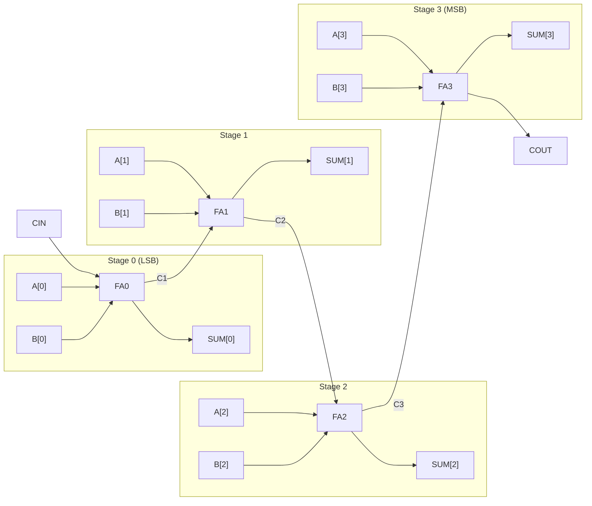

# 4-Bit Ripple Carry Full Adder in Verilog


-brightgreen.svg)


A modular, structural implementation of a **4-Bit Ripple Carry Full Adder** modeled in Verilog HDL. The design cascades four 1-bit full adder instances with internal carry propagation, accompanied by an automated, self-checking exhaustive testbench verifying all 512 input combinations.

---

## Table of Contents
- [Architecture & Design](#architecture--design)
  - [1-Bit Full Adder Module](#1-bit-full-adder-module)
  - [4-Bit Ripple Carry Adder Module](#4-bit-ripple-carry-adder-module)
- [Schematic & Block Diagram](#schematic--block-diagram)
- [Module Specifications](#module-specifications)
  - [Port List](#port-list)
  - [Truth Table](#truth-table)
- [Verification & Testbench](#verification--testbench)
- [Simulation Guide](#simulation-guide)
  - [Running on ModelSim / QuestaSim](#running-on-modelsim--questasim)
  - [Running on Icarus Verilog (Open-Source)](#running-on-icarus-verilog-open-source)
- [Repository Structure](#repository-structure)
- [License](#license)

---

## Architecture & Design

### 1-Bit Full Adder Module
The 1-bit full adder serves as the fundamental building block. It takes three 1-bit inputs ($A$, $B$, and Carry-in $CIN$) and produces two 1-bit outputs ($SUM$ and Carry-out $COUT$).

**Boolean Equations:**
- **Sum:**
  $$\text{SUM} = A \oplus B \oplus \text{CIN}$$
- **Carry-Out:**
  $$\text{COUT} = (A \cdot B) + (B \cdot \text{CIN}) + (A \cdot \text{CIN})$$

### 4-Bit Ripple Carry Adder Module
The 4-bit adder instantiates four `full_adder_1bit` units connected in a ripple-carry configuration:
- The external carry-in `CIN` feeds the least significant bit (LSB) stage `FA0`.
- The carry output `C1` ripples from `FA0` to `FA1`.
- The carry output `C2` ripples from `FA1` to `FA2`.
- The carry output `C3` ripples from `FA2` to `FA3`.
- The final carry output `COUT` is emitted from `FA3`.

---

## Schematic & Block Diagram



---

## Module Specifications

### Port List

#### 1. `full_adder_1bit` (Sub-Module)
| Port Name | Direction | Width | Description |
|:----------|:---------:|:-----:|:------------|
| `A`       | Input     | 1-bit | First operand bit |
| `B`       | Input     | 1-bit | Second operand bit |
| `CIN`     | Input     | 1-bit | Carry-in from previous stage |
| `SUM`     | Output    | 1-bit | Sum output bit |
| `COUT`    | Output    | 1-bit | Carry generated to next stage |

#### 2. `four_bit_full_adder` (Top Module)
| Port Name | Direction | Width | Description |
|:----------|:---------:|:-----:|:------------|
| `A`       | Input     | 4-bit | 4-bit operand vector `[3:0]` |
| `B`       | Input     | 4-bit | 4-bit operand vector `[3:0]` |
| `CIN`     | Input     | 1-bit | Input carry for LSB |
| `SUM`     | Output    | 4-bit | 4-bit sum result `[3:0]` |
| `COUT`    | Output    | 1-bit | Final carry-out bit (overflow) |

---

### Truth Table (1-Bit Full Adder)

| $A$ | $B$ | $CIN$ | $SUM$ | $COUT$ |
|:---:|:---:|:-----:|:-----:|:------:|
|  0  |  0  |   0   |   0   |   0    |
|  0  |  0  |   1   |   1   |   0    |
|  0  |  1  |   0   |   1   |   0    |
|  0  |  1  |   1   |   0   |   1    |
|  1  |  0  |   0   |   1   |   0    |
|  1  |  0  |   1   |   0   |   1    |
|  1  |  1  |   0   |   0   |   1    |
|  1  |  1  |   1   |   1   |   1    |

---

## Verification & Testbench

The verification environment (`4_bit_full_adder_tb.v`) implements an **exhaustive self-checking testbench**:
- **Total Vectors Tested:** $16 \times 16 \times 2 = \mathbf{512}$ combinations across all possible states of $A[3:0]$, $B[3:0]$, and $CIN$.
- **Golden Model:** Calculated on-the-fly using 5-bit arithmetic concatenation:
  $$\text{expected} = \{1'b0, A\} + \{1'b0, B\} + CIN$$
- **Automatic Checking:** Compares `{COUT, SUM} !== expected` for each vector at 10 ns intervals.
- **Reporting:** Displays per-case failure diagnostics and terminates with summary message:
  ```text
  -------------------------------------
      4-BIT FULL ADDER TESTBENCH
  -------------------------------------
  ...
  -------------------------------------
  ALL 512 TEST CASES PASSED!
  -------------------------------------
  ```

---

## Simulation Guide

### Running on ModelSim / QuestaSim

#### Method 1: ModelSim GUI
1. Open ModelSim/QuestaSim.
2. Select **File** &rarr; **Change Directory...** and browse to the repository directory.
3. In the Transcript window, compile the files:
   ```tcl
   vlib work
   vlog 4_bit_full_adder.v 4_bit_full_adder_tb.v
   ```
4. Start simulation:
   ```tcl
   vsim work.tb_four_bit_full_adder
   ```
5. Add signals to the wave window and run:
   ```tcl
   add wave -r /*
   run -all
   ```

#### Method 2: Command Line (CLI / Batch Mode)
```bash
vlib work
vlog 4_bit_full_adder.v 4_bit_full_adder_tb.v
vsim -c tb_four_bit_full_adder -do "run -all; quit -f"
```

---

### Running on Icarus Verilog (Open-Source)
If you prefer open-source simulation:
```bash
# Compile design and testbench
iverilog -o adder_sim 4_bit_full_adder.v 4_bit_full_adder_tb.v

# Execute simulation
vvp adder_sim
```

---

## Repository Structure

```text
4_bit_full_adder/
├── .gitignore              # Ignores ModelSim artifacts (work/, .wlf, .ini, logs)
├── 4_bit_full_adder.v      # Synthesizable RTL design (1-bit FA & 4-bit Ripple Carry FA)
├── 4_bit_full_adder_tb.v   # Self-checking exhaustive testbench (512 vectors)
└── README.md               # Project documentation, schematics, and simulation guide
```

---

## License

This project is licensed under the [MIT License](LICENSE) - open for educational and commercial digital design experimentation.
