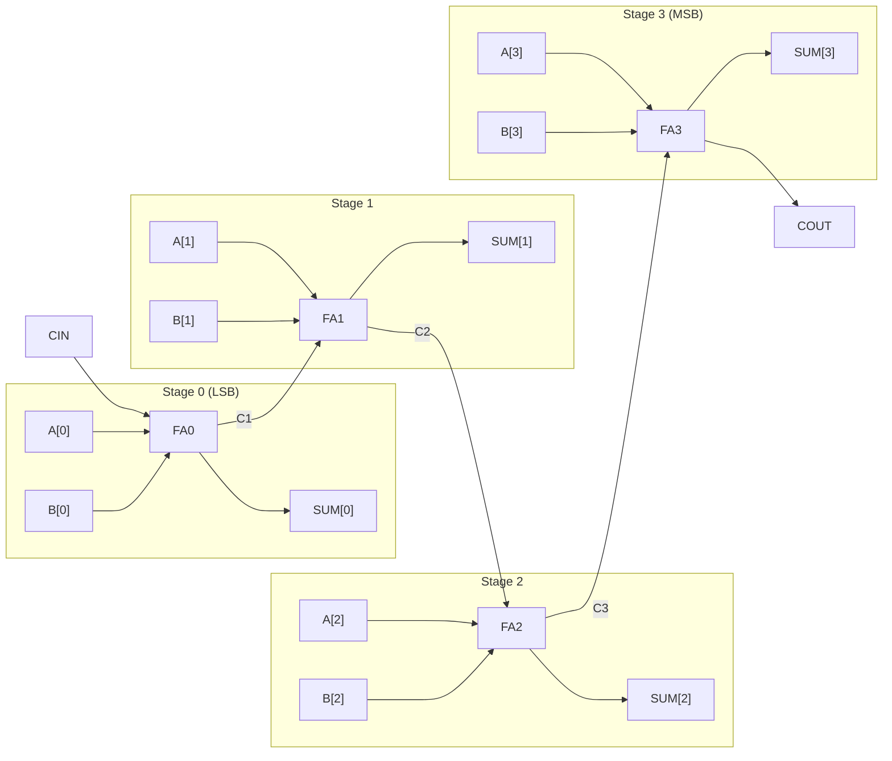

# 4-Bit Ripple Carry Full Adder
### Dual RTL & Verification Implementations: Verilog & SystemVerilog


-brightgreen.svg)


A modular, structural implementation and verification of a **4-Bit Ripple Carry Full Adder** implemented in both **Verilog (IEEE 1364-2001)** and **SystemVerilog (IEEE 1800)**. The design cascades four 1-bit full adder instances with internal carry propagation, paired with an automated, self-checking exhaustive testbench verifying all **512 input combinations**. Functional simulation and waveform output have been verified on **ModelSim**.

---

## 📋 Table of Contents
1. [Architecture & Digital Logic](#-architecture--digital-logic)
   - [1-Bit Full Adder Module](#1-bit-full-adder-module)
   - [4-Bit Ripple Carry Adder Module](#4-bit-ripple-carry-adder-module)
   - [Ripple Carry Adder vs. Full Adder Clarification](#ripple-carry-adder-vs-full-adder-clarification)
2. [Schematic & Carry Propagation Flow](#-schematic--carry-propagation-flow)
3. [Module Specifications](#-module-specifications)
   - [Port List](#port-list)
   - [Truth Table (1-Bit Full Adder)](#truth-table-1-bit-full-adder)
4. [Verilog vs. SystemVerilog Comparison](#-verilog-vs-systemverilog-comparison)
5. [Verification & Testbench Architecture](#-verification--testbench-architecture)
6. [ModelSim Simulation Guide (Completed Work)](#-modelsim-simulation-guide-completed-work)
   - [Method 1: Interactive ModelSim GUI (Waveform Viewer)](#method-1-interactive-modelsim-gui-waveform-viewer)
   - [Method 2: Command-Line (CLI / Batch Mode)](#method-2-command-line-cli--batch-mode)
7. [Timing & Waveform Analysis](#-timing--waveform-analysis)
8. [Repository Structure](#-repository-structure)
9. [License](#-license)

---

## 🏛️ Architecture & Digital Logic

### 1-Bit Full Adder Module
The 1-bit full adder is the core primitive cell. It accepts three 1-bit inputs ($A$, $B$, and Carry-in $CIN$) and generates two 1-bit outputs ($SUM$ and Carry-out $COUT$).

**Boolean Equations:**
- **Sum:**
  $$\text{SUM} = A \oplus B \oplus \text{CIN}$$
- **Carry-Out:**
  $$\text{COUT} = (A \cdot B) + (B \cdot \text{CIN}) + (A \cdot \text{CIN})$$

### 4-Bit Ripple Carry Adder Module
The top-level 4-bit adder cascades four 1-bit full adders in series:
- **Bit 0 (LSB - `FA0`):** Adds $A[0]$, $B[0]$, and the external carry-in `CIN`, producing $SUM[0]$ and intermediate carry `C1`.
- **Bit 1 (`FA1`):** Adds $A[1]$, $B[1]$, and `C1`, producing $SUM[1]$ and intermediate carry `C2`.
- **Bit 2 (`FA2`):** Adds $A[2]$, $B[2]$, and `C2`, producing $SUM[2]$ and intermediate carry `C3`.
- **Bit 3 (MSB - `FA3`):** Adds $A[3]$, $B[3]$, and `C3`, producing $SUM[3]$ and the final carry-out `COUT`.

### Ripple Carry Adder vs. Full Adder Clarification
- **Full Adder**: Strictly refers to a **1-bit** primitive circuit adding 3 single-bit inputs.
- **Ripple Carry Adder (RCA)**: The formal name of the **multi-bit** circuit formed by cascading full adders where the carry ripples from LSB to MSB.
- **Why no Half Adder is used**: Bit 0 incorporates a **Full Adder** because the module supports an external carry-in `CIN` (crucial for adder chaining and 2's complement subtraction).

---

## 🔄 Schematic & Carry Propagation Flow



---

## 📊 Module Specifications

### Port List

#### 1. `full_adder_1bit` (Sub-Module)
| Port Name | Direction | Verilog Type | SystemVerilog Type | Width | Description |
|:----------|:---------:|:------------:|:------------------:|:-----:|:------------|
| `A`       | Input     | `wire`       | `logic`            | 1-bit | First operand bit |
| `B`       | Input     | `wire`       | `logic`            | 1-bit | Second operand bit |
| `CIN`     | Input     | `wire`       | `logic`            | 1-bit | Carry-in from previous stage |
| `SUM`     | Output    | `wire`       | `logic`            | 1-bit | Sum output bit |
| `COUT`    | Output    | `wire`       | `logic`            | 1-bit | Carry-out generated to next stage |

#### 2. `four_bit_full_adder` (Top Module)
| Port Name | Direction | Verilog Type | SystemVerilog Type | Width | Description |
|:----------|:---------:|:------------:|:------------------:|:-----:|:------------|
| `A`       | Input     | `wire [3:0]` | `logic [3:0]`      | 4-bit | 4-bit first operand vector |
| `B`       | Input     | `wire [3:0]` | `logic [3:0]`      | 4-bit | 4-bit second operand vector |
| `CIN`     | Input     | `wire`       | `logic`            | 1-bit | External carry-in input |
| `SUM`     | Output    | `wire [3:0]` | `logic [3:0]`      | 4-bit | 4-bit arithmetic sum vector |
| `COUT`    | Output    | `wire`       | `logic`            | 1-bit | Final carry-out / overflow flag |

---

### Truth Table (1-Bit Full Adder)

| $A$ | $B$ | $CIN$ | $SUM$ | $COUT$ | Arithmetic Equivalent ($A + B + CIN$) |
|:---:|:---:|:-----:|:-----:|:------:|:-------------------------------------:|
|  0  |  0  |   0   |   0   |   0    |                   0                   |
|  0  |  0  |   1   |   1   |   0    |                   1                   |
|  0  |  1  |   0   |   1   |   0    |                   1                   |
|  0  |  1  |   1   |   0   |   1    |                   2                   |
|  1  |  0  |   0   |   1   |   0    |                   1                   |
|  1  |  0  |   1   |   0   |   1    |                   2                   |
|  1  |  1  |   0   |   0   |   1    |                   2                   |
|  1  |  1  |   1   |   1   |   1    |                   3                   |

---

## ⚡ Verilog vs. SystemVerilog Comparison

This repository provides identical structural architectures in both languages, illustrating modern SystemVerilog enhancements:

| Aspect | Verilog Implementation (`.v`) | SystemVerilog Implementation (`.sv`) | Advantage of SystemVerilog |
|:-------|:-----------------------------|:-------------------------------------|:----------------------------|
| **Data Types** | `wire` for nets, `reg` for testbench drivers | Unified 4-state `logic` type everywhere | Eliminates confusion between `wire` and `reg` |
| **Internal Nets** | `wire C1, C2, C3;` | `logic C1, C2, C3;` | Consistent declaration syntax |
| **Loop Indices** | `integer i, j, k;` (4-state 32-bit) | `int i, j, k;` (2-state 32-bit signed) | Faster simulation runtime and cleaner syntax |
| **Loop Syntax** | `for (i = 0; i < 16; i = i + 1)` | `for (i = 0; i < 16; i++)` | C-style post-increment operator (`++`) |
| **Error Counter** | `errors = errors + 1;` | `errors++;` | Compact increment arithmetic |
| **Port Definition** | `input [3:0] A` | `input logic [3:0] A` | Explicit type safety in port list |

---

## 🧪 Verification & Testbench Architecture

Both testbenches (`4_bit_full_adder_tb.v` and `4_bit_full_adder_tb.sv`) implement an **exhaustive self-checking verification environment**:

- **Total Test Cases**: $16 \times 16 \times 2 = \mathbf{512}$ vectors covering all combinations of $A \in [0, 15]$, $B \in [0, 15]$, and $CIN \in [0, 1]$.
- **Golden Reference Model**:
  $$\text{expected}[4:0] = \{1'b0, A\} + \{1'b0, B\} + CIN$$
- **Automatic Checking**:
  Every vector asserts `{COUT, SUM} === expected` after a 10 ns propagation delay:
  ```systemverilog
  expected = {1'b0, A} + {1'b0, B} + CIN;
  #10;
  if ({COUT, SUM} !== expected) begin
      $display("FAILED: A=%b B=%b CIN=%b SUM=%b COUT=%b EXPECTED=%b", A, B, CIN, SUM, COUT, expected);
      errors++;
  end
  ```
- **Console Results**:
  ```text
  -------------------------------------
    4-BIT FULL ADDER TESTBENCH
  -------------------------------------
  -------------------------------------
  ALL 512 TEST CASES PASSED!
  -------------------------------------
  ```

---

## 🛠️ ModelSim Simulation Guide (Completed Work)

All functional simulations and waveform generation have been performed and verified using **Mentor Graphics / Intel ModelSim**.

### Method 1: Interactive ModelSim GUI (Waveform Viewer)

#### To simulate SystemVerilog:
1. Open ModelSim.
2. Change directory to the repository folder:
   ```tcl
   cd "path/to/4_bit_full_adder"
   ```
3. Compile the SystemVerilog design and testbench:
   ```tcl
   vlib work
   vlog -sv systemverilog/4_bit_full_adder.sv systemverilog/4_bit_full_adder_tb.sv
   ```
4. Load the simulation:
   ```tcl
   vsim work.tb_four_bit_full_adder
   ```
5. Add all signals to the Wave window and run:
   ```tcl
   add wave -r /*
   run -all
   wave zoomfull
   ```

#### To simulate Verilog:
```tcl
vlib work
vlog verilog/4_bit_full_adder.v verilog/4_bit_full_adder_tb.v
vsim work.tb_four_bit_full_adder
add wave -r /*
run -all
wave zoomfull
```

---

### Method 2: Command-Line (CLI / Batch Mode)

Run directly from PowerShell or Command Prompt:

```powershell
# For SystemVerilog:
vlib work
vlog -sv systemverilog/4_bit_full_adder.sv systemverilog/4_bit_full_adder_tb.sv
vsim -c tb_four_bit_full_adder -do "run -all; quit -f"

# For Verilog:
vlib work
vlog verilog/4_bit_full_adder.v verilog/4_bit_full_adder_tb.v
vsim -c tb_four_bit_full_adder -do "run -all; quit -f"
```

---

## 📈 Timing & Waveform Analysis

In ModelSim's **Wave Viewer**, each test vector is applied with a period of `10 ns`:

```text
Time (ns): 0       10      20      30      40      ...  5110    5120
           |-------|-------|-------|-------|-------|    |-------|
A[3:0]     --<0x0>---<0x0>---<0x0>---<0x0>---<0x1>--    --<0xF>-
B[3:0]     --<0x0>---<0x0>---<0x1>---<0x1>---<0x0>--    --<0xF>-
CIN        ---0-------1-------0-------1-------0----    ---1----

SUM[3:0]   --<0x0>---<0x1>---<0x1>---<0x2>---<0x1>--    --<0xF>-
COUT       ---0-------0-------0-------0-------0----    ---1----
```

### Key Waveform Scenarios Observed:
1. **Zero State ($A=0, B=0, CIN=0$):**
   - At $t = 0\text{ ns}$: $SUM = 0000_2$, $COUT = 0$.
2. **Carry-In Propagation ($A=0, B=0, CIN=1$):**
   - At $t = 10\text{ ns}$: $SUM = 0001_2$, $COUT = 0$.
3. **Carry Ripple Across Slices ($A=15, B=0, CIN=1$):**
   - Carry ripples through $C1 \to C2 \to C3 \to COUT$, producing $SUM = 0000_2$ and $COUT = 1$ ($15 + 0 + 1 = 16$).
4. **Full Scale Maximum Addition ($A=15, B=15, CIN=1$):**
   - At $t = 5110\text{ ns}$: $SUM = 1111_2\ (15)$ and $COUT = 1\ (16)$, representing $15 + 15 + 1 = 31$.

---

## 📁 Repository Structure

```text
4_bit_full_adder/
├── verilog/
│   ├── 4_bit_full_adder.v         # Verilog synthesizable RTL (1-bit FA & 4-bit RCA)
│   └── 4_bit_full_adder_tb.v      # Verilog exhaustive self-checking testbench
├── systemverilog/
│   ├── 4_bit_full_adder.sv        # SystemVerilog synthesizable RTL (logic data types)
│   └── 4_bit_full_adder_tb.sv     # SystemVerilog exhaustive testbench (int, logic)
├── .gitignore                     # Ignores ModelSim artifacts (work/, .wlf, .ini, logs)
├── LICENSE                        # MIT License
└── README.md                      # Complete architectural and simulation documentation
```

---

## 📜 License

This project is licensed under the [MIT License](LICENSE) - free for educational, academic, and industrial hardware development experimentation.
